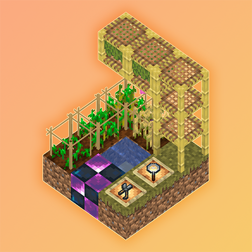

# HarvestHeritage · 收获：遗产

[EN_US](README_EN.md)

> "我很敬佩第一个从草里打出种子的人——说不定那是小麦种子呢。"

---

## 开始

从打草开始的~~坐牢之旅~~。

> ~~模组作者小时候玩 GTNH ，被里面 IC2 杂交调教好了写的。~~

1. 合成除草剪打草，获取未知种子
2. 未知种子用放大镜扫一下合成已知种子。
3. 已知种子和纸合成种子袋。
4. 用四根木棍合成作物架。
5. 种子袋种作物架上。
6. 等他成熟，长不大可能是条件没符合，看看 JEI。
7. 杂交什么的装个 GuideME 吧，有点复杂了，机制都写里面了。

> ~~我觉得未知种子、已知种子很脱裤子放屁，以后删了~~

## 可选模组

> 完全可选的模组，装了能提升体验。

1. JEI
2. Jade
3. GuideME(手写部分后用 AI 润了润，和这里 readme 的风格有很大不同)

## 联动种子

目前只写了 AE2 的联动种子(赛特斯、福鲁伊克斯、陨石、物质球、奇点)。

其他的暂时还没写(想写的模组都没升上来，或者是不想写)。

如果有想联动的种子可以在 issue 里面提一嘴，马上加上。

可以自行添加更多种子以及杂交配方。(文档正在编写中.soon)

## ❤️ 致谢

- **theabab2333** — 作者
- **Abslb** & **GTriXy** — 贡献者
