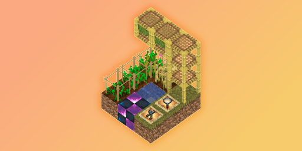

---
navigation:
  title: 介绍
  position: 0
---

# 什么是 HarvestHeritage？

HarvestHeritage 新增了物品与方块，为部分资源提供新的生产方案。

你还可以通过杂交改良种子，获得更多产物。

杂交系统灵感来自 IC2（？），至少这里没有杂草。

## 如何使用本指南

通过左侧边栏查找所需内容。

## 联动

### 实用模组

- 安装 JEI 后可查看种子信息与杂交配方。
- 安装 Jade 后可在提示框中查看作物架状态。
- 安装 GuideME 后可阅读本指南。
- 更多联动内容后续补充。

### 更多种子

- 为其他模组的资源添加对应种子。（但是没添加完.png）

<GameScene zoom="4">
  <ImportStructure src="assets/structure/logo.snbt"></ImportStructure>
  <IsometricCamera yaw="135" pitch="45"></IsometricCamera>
</GameScene>
