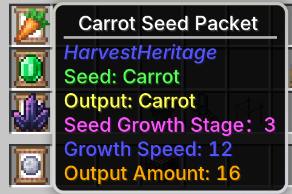

---
navigation:
  title: 机制
  position: 20
---

# 机制

这里汇总了模组的机制。

## 生长

<CategoryIndex category="grow"></CategoryIndex>

## 杂交

<CategoryIndex category="hybrid"></CategoryIndex>

## 数值

模组给种子添加 3 种数值，分别是 **生长阶段** 、 **生长速度** 和 **产出数量**。

- 生长阶段：作物的生长阶段。
- 生长速度：影响每次随机刻进入下一生长阶段的概率。
- 产出数量：影响成熟收获时实际掉落的产物数量。

生长速度和产出数量可以在配置文件中修改，也会**随着作物间的杂交而增减**，
总体来说还是**增的多**~~(祝福你)~~。

<CategoryIndex category="numerical"></CategoryIndex>

## 其他